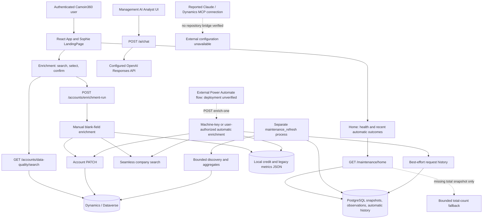
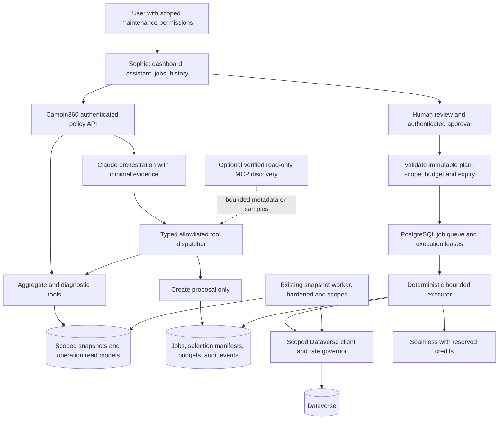

# Sophie Maintenance technical and functional audit

**Audit date:** November 18, 2026. **Application:** Camoin360, current working checkout. **Mode:** audit only; no implementation authorized by this report.

## 1. Executive Summary

Sophie Maintenance currently provides two user-facing views: **Home** and **Enrichment**. Home displays cached Dynamics Account totals, persisted Dataverse Data Health aggregates, and recent new Accounts with automatic-enrichment outcomes. Enrichment searches Dynamics on demand, lets users select Accounts and fields, and synchronously fills blank fields using Seamless AI company search. A separate Python worker refreshes read models. A machine-authenticated endpoint is ready for an external Power Automate new-Account trigger.

This is a useful enrichment and observation foundation, but it is **not yet a general maintenance job platform**. There is no durable write-job queue, approval-bound execution plan, pause/resume interface, complete maintenance history, NAICS hierarchy/title backfill, or Data Health recalculation engine in the repository. The new Claude/Dynamics MCP connection is user-reported; its actual server, transport, tools, credentials, and permissions cannot be established from this checkout or this session's available tools.

**Recommended direction:** start with **Option B: Claude calls narrow, controlled Camoin360 tools**, backed by existing deterministic services. Permit **Option C: optional read-only MCP discovery** later, after the actual connector is inspected. Keep approved bulk execution inside Camoin360 workers. Do not give the model a general Dynamics write tool or send it thousands of records.

### Evidence standard and audit boundaries

- **Verified:** directly supported by inspected source or the safe local checks below. This establishes implementation, not production deployment or successful production operation.
- **Partial:** meaningful implementation exists, but a missing integration, safety property, or operating mechanism prevents the full capability.
- **Dormant/legacy:** implemented but not reachable through current Sophie navigation; an API may still be reachable.
- **External/unverified:** requires infrastructure, Dataverse metadata/security configuration, Power Automate exports, logs, or MCP configuration unavailable in the repository.
- **Proposed:** future work, not an existing feature.

The checkout already contained substantial modified and untracked files. This audit evaluates those current files, including the recent removal of Duplicate Accounts, rather than assuming Git HEAD matches the running or deployed application. Prior README deployment assertions are historical evidence, not independent verification. Actual Render configuration, Dataverse permissions, production schema/indexes, load, and flow definitions were not inspected.

No application server imports, network calls to Dynamics/Seamless/AI, database connections, schema changes, maintenance jobs, flow triggers, deployments, or write-capable MCP calls were made for this audit. Credentials, environment-file contents, client records, and telemetry JSON contents were not copied into the report. Only this report was created.

**Safe local validation performed:** parsed 99 Python application/test files and 63 frontend JavaScript source/test files without executing the application; exercised the actual pure NAICS normalizer on 10 boundary cases and geographic normalizer on 5 cases; statically verified retired duplicate-account read/delete routes are absent. All passed. Existing tests were inspected as evidence of intended behavior, not rerun: some database test helpers create/drop schemas and fall back to the runtime database, which is inappropriate under this audit's rules. No production performance benchmark or end-to-end UX test was performed.

### Preserve these capabilities

1. Explicit field selection, blank-only enrichment, per-Account outcomes, and uncertainty after unconfirmed writes.
2. Bounded server-side aggregations, retention-limited observations, durable continuation checkpoints, and PostgreSQL advisory locks.
3. Honest treatment of missing/stale data, unknown history, unclassified Accounts, and provider calls that add no fields.
4. Canonical Seamless mappings, company-name matching, unpaid eligibility checks, and automatic attempt metadata.
5. PostgreSQL user authentication, signed expiring JWTs, server-side module checks, and restricted machine authentication.

### Five largest usability or efficiency problems

| Finding | Impact | Priority |
| --- | --- | --- |
| F1: No durable write-job lifecycle | A browser request owns execution; leaving, timing out, or retrying gives no reliable recovery, progress, or complete history. | P1, with P0 execution safeguards |
| F2: Organization identity is not enforced in maintenance data access | Module permission grants access to the globally configured Dynamics environment; user organization is not a record boundary. | P0 |
| F3: Credit accounting and duplicate prevention are not transactional | Concurrent requests/instances can repeat paid lookups, lose usage updates, or race human edits. | P0 |
| F4: Data discovery and prioritization are fragmented | Health, completeness, enrichment eligibility, recent outcomes, and legacy missing-field metrics describe different populations; no guided next action. | P1 |
| F5: Paging replays work; legacy routes can initiate broad refreshes | Current bounded searches re-read preceding pages, while legacy cache refreshes can enumerate Accounts and replace a local mirror. | P1 |

### Source reference index

Links are relative to this document. Function names identify the relevant implementation even as line numbers change.

| ID | Source and relevant entry points |
| --- | --- |
| E01 | [Application shell](../frontend/src/App.js), [Sophie navigation](../frontend/src/landingPage.js): `App`, `LandingPage`, `getViewForPath`, `prefetchView`. |
| E02 | [Home UI](../frontend/src/components/MaintenanceHome.js), [health chart](../frontend/src/components/AccountDataHealthChart.js): refresh, warning, status, pagination and KPI presentation. |
| E03 | [Enrichment workspace](../frontend/src/components/EnrichmentWorkspace.js): `search`, `run`, `enrichmentFields`, `stateOptions`, confirmation and result dialogs. |
| E04 | [Account routes](../backend/app/routes/accounts.py): all `/accounts/*` contracts, request models, cache invalidation, machine key dependency; also contains Prospecting routes. |
| E05 | [Dynamics services](../backend/app/services/dynamics.py): Account reads/search/cache, `enrich_one_account`, `enrich_account`, `enrich_selected_accounts`, `enrich_accounts`, `update_account`, `revert_account_fields`. |
| E06 | [Seamless adapter](../backend/app/services/seamless.py): `enrich_with_seamless`, `normalize_naics_code`, `get_match_confidence`; [location rules](../backend/app/services/locations.py). |
| E07 | [Home routes](../backend/app/routes/maintenance.py), [Home read model](../backend/app/services/maintenance_home.py), [total fallback](../backend/app/services/maintenance_total.py). |
| E08 | [Observation services](../backend/app/services/maintenance_observations.py), [bounded Dynamics client](../backend/app/services/maintenance_dynamics.py): refresh configuration, locks, discovery, counts and continuation validation. |
| E09 | [Health aggregation](../backend/app/services/maintenance_data_health.py), [sector aggregation](../backend/app/services/account_sector_summary.py): weighted aggregates, interval splitting, request budgets and concurrency. |
| E10 | [Refresh worker](../backend/app/workers/maintenance_refresh.py): `run_worker`, `run_cycle`, `read_due_plan`, `_until_stop`. |
| E11 | [Automatic attempt history](../backend/app/services/account_enrichment_history.py): `AutomaticAttempt`, `automatic_enrichment_request`, provider activity checkpoints. |
| E12 | [Database DDL and connection layer](../backend/app/database.py), [auth schema verifier](../backend/app/application_users_schema.py), [Alembic scaffold](../backend/alembic/env.py). |
| E13 | [Application middleware/lifespan](../backend/app/main.py), [auth routes](../backend/app/routes/auth.py), [user persistence](../backend/app/services/application_users.py), [auth configuration](../backend/app/services/application_auth_configuration.py), [module policy](../backend/app/services/application_auth_policy.py). |
| E14 | [Dynamics OAuth](../backend/app/services/auth.py), [credit usage](../backend/app/services/usage.py), [legacy metrics storage](../backend/app/services/metrics.py), [legacy metrics API](../backend/app/routes/metrics.py). |
| E15 | [Existing AI endpoint](../backend/app/routes/ai.py), [chat UI](../frontend/src/components/AiChatBox.js), [Management dashboard](../frontend/src/managementDashboard.js). |
| E16 | [Browser auth](../frontend/src/auth.js), [browser request cache](../frontend/src/apiClient.js), [backend request cache](../backend/app/services/cache.py). |
| E17 | [Legacy data-quality table](../frontend/src/components/DataQualityTable.js), [filters](../frontend/src/components/DataQualityFilters.js), [summary](../frontend/src/components/DataQualitySummary.js), [field selector](../frontend/src/components/FieldUpdateSelector.js), [metrics dashboard](../frontend/src/components/MetricsDashboard.js), [sector chart](../frontend/src/components/AccountsBySector.js), [old run button](../frontend/src/components/RunEnrichmentButton.js). |
| E18 | [README](../README.md): Power Automate contract; Home steps; refresh worker; canonical enrichment fields; auth deployment procedure. [Test database helper](../backend/app/testing_support.py); [backend dependencies](../backend/requirements.txt), [root dependencies](../requirements.txt), [frontend hosting rewrite](../frontend/vercel.json). |

## 2. Current Architecture

### Confirmed application structure

All backend routes share the FastAPI app in E13. The Sophie module identifier is `main`; navigation is Home and Enrichment. `/dashboard/seamless` and `/dashboard/data-quality` redirect to Enrichment; retired Duplicate Accounts and Summary Analytics bookmarks redirect to Home. The application selects a dashboard using stored allowed-module preferences, not solely the URL. Duplicate detection and Account deletion code were removed before this audit. E01–E05.

The web lifespan verifies the auth schema/signing configuration and starts the newsletter scheduler. It does **not** start `maintenance_refresh`. The worker must be deployed/run independently. README text claiming the web module initializes all business tables at import is stale against current `main.py`: business initialization is reached lazily through `get_database_connection`; the refresh worker explicitly initializes it. E10, E12–E13, E18.

### Implemented versus deployed

| Layer | Repository status | What remains unverified |
| --- | --- | --- |
| React Home/Enrichment | Implemented, routed, with tests. | Browser accessibility, production hosting settings and real-user success. |
| Account API and Seamless writes | Implemented, callable by authorized users. | Production provider credentials, service roles, quotas and operational success. |
| Snapshot worker | Implemented as separate process; bounded due cycles. | Whether a production instance is running and meeting freshness targets. |
| Automatic enrichment | Complete endpoint/service contract; external trigger required. | Actual deployed Power Automate trigger, retries, concurrency and filtering. |
| AI Analyst | Implemented for Management, using OpenAI; no tools. | Provider configuration and real deployed usage. |
| Claude/MCP | No application integration found. | Actual connection type, server deployment, tool list, identities and rights. |
| General maintenance jobs | Absent. | Not established by sync-state/history tables. |

## 3. Existing Features and Capabilities

“Operational” below means the execution path is implemented. Production operation was not exercised.

### Capability inventory

| Capability | Status / user access | Execution and data effects | Limitations and risks |
| --- | --- | --- | --- |
| Total Accounts | Implemented, Home KPI. | `maintenance_refresh` → `refresh_total_account_count` → `RetrieveTotalRecordCount`; PostgreSQL snapshot; cache-aside read if missing. No Dynamics writes. | Source is a platform snapshot, not an exact live filtered count. Production freshness depends on worker. E07–E10. |
| Data Health distribution and average | Implemented, Home. | `refresh_data_health` aggregates existing score/Choice fields; stores singleton snapshot. No score writes. | Scoring algorithm and upstream recalculation are external/unverified. E09. |
| Recent new Accounts and attention statuses | Implemented, Home. | Observation discovery plus latest meaningful automatic attempt; PostgreSQL read model. | Retention-limited new-Account population; not all existing Accounts or all maintenance runs. E02, E07–E08, E11. |
| Creation counts, enrichment success metric | Backend implemented; not currently rendered as a creation chart/success KPI in Home. | Cached daily aggregates and observed-week outcomes returned by `/maintenance/home`. | README describes older UI; do not infer visible functionality from the response. E02, E07, E18. |
| Canonical missing-field/health search | Implemented, Enrichment → Search Dynamics. | `search_accounts_data_quality_from_dynamics(enrichment_fields=True)` queries selected columns; no write/mirror. | 25-row UI pages; 5,000-result window; no population-wide missing-field count. E03–E05. |
| Selected manual enrichment | Implemented, Enrichment → select → fields → confirm. | `/accounts/enrichment-run` → `enrich_selected_accounts` → `enrich_account`; paid provider search, Account PATCH, JSON usage/metrics writes. | Synchronous, no durable job, server-side list maximum, deduplication, approval record or checkpoint. E03–E06, E14. |
| Automatic new-Account enrichment | Endpoint implemented; trigger external. | `/accounts/enrich-one/{id}` → request history → `enrich_one_account`; paid search, attempt flag/timestamp and blank-field PATCH. | Sequential repeat protection only; concurrent deliveries race. Flow must interpret body status even on HTTP 200. E04–E06, E11. |
| Enrichment preview | Mock only; legacy/internal API. | `/accounts/enrichment-preview` returns `source: mock`, ready status and submitted IDs. No provider/Dynamics operations. | Not validation, cost estimation, a before/after diff or an approvable plan. E04. |
| Legacy bulk enrichment | Implemented API, absent from current navigation. | `/accounts/enrich-all` processes `get_accounts_needing_enrichment()` results sequentially. Writes Dynamics. | Only top 10 US Accounts missing website/phone; misleading “all”; no queue or checkpoint. E04–E05. |
| Legacy revert operations | Implemented API, absent from current navigation. | `/accounts/revert/{id}`, `/revert-email/{id}`, `/revert-phone/{id}` clear email/phone via PATCH. | Destructive clearing, not restoration from history; no special approval/admin check beyond module middleware. E04–E05, E13. |
| Duplicate Accounts | Removed. | Screen, matching service, duplicate endpoints and Account delete endpoint absent. | Do not plan around reusing the removed implementation. Name matching in Seamless is provider identity matching, not duplicate detection. |
| Geographic normalization | Partial, enrichment validation and comparisons. | Pure US/Canada rules; manual state updates normalize recognized names to abbreviations. | No general cleanup operation or mismatch inventory. Automatic writes do not use the same state normalization. E05–E06. |
| Scheduled write maintenance / job control | Absent. | Read-only snapshot worker exists; no durable write-job model or scheduler. | No create/approve/pause/resume/cancel workflow. E10–E12. |

### NAICS maintenance: precise boundary

**Existing:** Seamless `naicsCode` maps to `cr73c_naicscode`. `normalize_naics_code` accepts string/integer values containing **2–6 ASCII digits**, preserving string leading zeros. Booleans, floats, non-ASCII digits, punctuation and other lengths are rejected. Canonical manual enrichment offers NAICS selection and missing-NAICS filtering; automatic enrichment considers a blank canonical NAICS field credit-worthy. Both fill blanks only. E03, E05–E06.

**Not present:** separate two-, three-, four-, five-, and six-digit hierarchy assignment; reference-edition validation; a NAICS title resolver/populator; hierarchy consistency validation; a dedicated backfill job; NAICS-specific processing flag, timestamp, error queue or recovery checkpoint. Accepting a 2–6 digit string does not demonstrate the code exists in an authoritative NAICS edition or is appropriate for a company.

`new_naicstext` appears in legacy completeness/missing-field logic. Other candidates such as `cr73c_naicsprefix`, `new_naicsprefixcode`, `naicscode`, `new_naicscode`, and `new_naics` lookup discovery appear in marketing/target-industry readers (`_fetch_target_industry_naics_codes`, `_fetch_naics_codes`, `_fetch_account_naics_codes`). These are **reads used for targeting**, not Sophie title/hierarchy writes. A custom table named `new_naics` is not evidence of a working title backfill. E05.

Only generic enrichment flags are written: `cr73c_enrichmentattempted` and UTC `cr73c_enrichmentlastattemptedon`. Manual enrichment does not maintain these automatic-path flags. A provider/configuration/credit/write failure generally leaves the automatic flag unconfirmed and permits another submission; a completed no-match or missing-name evaluation marks attempted when PATCH succeeds. No automatic retry scheduler exists. E05, E11.

**Recommendation — P1:** inventory canonical field metadata and external NAICS flows before choosing a reference dataset/edition. Then build deterministic validation and hierarchy/title derivation as an approved job type. Use AI for explaining exceptions or suggesting candidates with evidence, not as the source of authoritative codes.

### Data Health versus completeness

There are distinct concepts that must remain explicit:

1. **Persisted Data Health:** `cr73c_datahealthscore`, plus `cr73c_datahealth` Choice values Poor `732660000`, Needs Enrichment `732660001`, Good `732660002`, Excellent `732660003`. Home aggregates these values. Average = total score sum / non-null scored Accounts; classification percentages use classified Accounts, excluding unknown classifications. These mappings are repository constants; their earlier metadata verification is documented but was not repeated. E09.
2. **Computed completeness:** four 20-point buckets for website, phone, description and employees, plus 20 points only when city/state/country are all present. Legacy scoring uses `new_employees`; canonical enrichment search uses `numberofemployees`. Postal code and NAICS can be missing despite 100% completeness. The workspace shows both completeness and persisted Health Score. E03, E05.
3. **Enrichment eligibility:** automatic paid lookup requires at least one missing website, phone, employees, postal code or NAICS field; optional description/location gaps alone do not initiate automatic paid search. Manual selection uses a different rule: a selected missing supported field can initiate search. E05.

There is **no repository engine that recalculates or writes persisted Data Health scores/choices**, and no score-recalculation schedule. Refreshing the health snapshot updates reporting, not Account scores. The README references external scoring flows; their actual formulas, coverage, triggers and backfills are unverified. Missing detection is primarily null/blank detection, not semantic validation of populated values. Invalid populated NAICS/state values are not corrected by blank-only enrichment.

### Enrichment safeguards and gaps

- Nine canonical targets: website, phone, description, employees, city, state/province, country, postal code, NAICS. Existing populated values are excluded based on the initial read. Manual validation includes HTTP(S) URLs without embedded credentials, bounded nonnegative employee integers, textual postal codes and NAICS syntax. Automatic employee parsing is less strict; geographic outputs also differ. E05–E06.
- Seamless searches by company name and available location, requesting up to five candidates. It retries without location if no usable candidate is returned. Usable candidates require domain or phone, so a potentially useful NAICS-only candidate can be discarded. Company-name matching is mandatory; confidence counts matching name/domain/phone/country/state. There is no minimum multi-signal confidence threshold beyond name matching. E06.
- Weekly cap is 2,000 **adapter invocations**, not guaranteed actual billable credits. A fallback produces two HTTP searches. Automatic usage increments even when the adapter fails; manual usage increments after successful adapter return, including no match, but not on adapter failure. Provider request counts are durably observed only in the automatic path. Exact billing must be reconciled with the provider contract. E05–E06, E11, E14.
- Read-before-write blank preservation is helpful but not concurrency-safe: Account PATCH lacks ETag conditions, and automatic eligibility lacks an atomic per-Account claim. A concurrent human edit or second request can race the first read. No transaction spans PostgreSQL, Seamless and Dataverse. E05, E11.

## 4. Frontend and User Experience Assessment

### Current user journeys

**Observe:** sign in with `main` permission → Home → inspect four KPIs and Data Health chart → inspect Recent or Needs Attention → Load more. Home fetches 14-day count data but recent rows use the configured 30-day observation retention, not a complete historical Account inventory. There are no row-level repair actions, Account deep links, job details or click-through from health categories to filtered work. E01–E02, E07.

**Enrich:** open Enrichment → choose search, missing fields with AND/OR, geography, sector and persisted health → Search Dynamics → select up to the currently displayed 25 Accounts → choose fields to enrich → confirm blank-only policy → wait for the POST to finish → inspect summary and expandable per-Account outcomes. Selection resets when searching/paging. Results live in component state; navigating away loses the run report. E03.

### Strengths

- Simple two-item navigation; explicit search avoids automatic population loading.
- Responsive tables, loading states, empty states, field labels, confirmation, and per-record outcome details.
- Missing information is visible; populated fields are protected by application policy.
- Home distinguishes pending, processing, delayed, credit limit, no usable match, unknown history and unconfirmed updates rather than reporting everything as success.
- Home uses load-more pagination, preserves data during background revalidation, and shows stale/partial information. E01–E03.

### Usability findings and proposed simplifications

| Finding | Current technical knowledge required | Recommendation |
| --- | --- | --- |
| Health does not lead to action | Understand which classification/filter to choose and which missing field justifies paid enrichment. | **P1:** click a dashboard issue to open a prefiltered, explained worklist with eligible count and freshness. |
| Completeness and Health Score disagree legitimately | Understand legacy versus canonical employee fields and excluded NAICS/postal gaps. | **P1:** consistent labels and definitions; show missing required fields separately from score and provider eligibility. |
| No visible credit estimate/balance in current Sophie components | Know the weekly allowance and provider fallback behavior outside the confirmation flow. | **P1:** reuse `/maintenance/enrichment/credits`; show balance age, reserved budget and bounded estimate before approval. Navigation prefetches this endpoint, but no current Sophie component renders its response. |
| State filter sends abbreviations, while records may contain full names | Know raw storage format; exact OData state equality can omit semantically identical values. | **P1:** query accepted aliases/canonical index and add an explicit inconsistency worklist. Verify real storage distribution before migration. |
| Generic errors and one long wait | Determine whether provider search, budget, Dynamics read or PATCH failed; decide if retry is safe. | **P1:** durable run progress, stage-specific sanitized errors, retry eligibility and an unconfirmed-write reconciliation action. |
| History is split and incomplete | Know that Home reports automatic new-Account outcomes, while manual results disappear. | **P1:** shared history view with source, actor, job, affected counts and evidence coverage. |
| No guided maintenance operation | Know filters, field policies, edition rules and provider limits. | **P2:** saved deterministic task templates and natural-language planning over approved tools. |

The current AI Analyst is outside Sophie. Its Management parent supplies view name/title/description/date-filter metadata, **not loaded metric values**, despite the chat UI saying it uses currently loaded data. Reusing the component without server-built evidence would create misleading diagnostics. It also sends an ever-growing message list while the API allows at most 12 messages, eventually producing validation errors. E15.

### Requested natural-language questions: current feasibility

| Request | What can be reused now | What must be developed |
| --- | --- | --- |
| “How many accounts are missing NAICS codes?” | Canonical missing-NAICS predicate and live search. | Bounded server-side filtered aggregate with tenant/environment scope, snapshot age and NAICS definition. Current search returns a page count, not a population count; legacy missing-NAICS-text counts measure a different field. |
| “What are the biggest data quality problems?” | Health distribution; legacy missing-field rules; canonical missing predicates. | Canonical cross-population issue metrics and ranking. Current live workspace has no global issue counts; legacy mirror may be stale or incomplete. |
| “Why did the last maintenance job fail?” | Automatic attempt reason codes/uncertainty and worker sync error categories. | Durable job identity, phase/record outcomes, approved diagnostic read API and user-friendly explanation. No general job exists today. |
| “Which accounts should we enrich next?” | Missing-field/health filters, credit-worthy policy and matching adapter. | Explainable eligibility ranking, paid-request deduplication, tenant policy, budget reservations and bounded worklist tool. |
| “Show me records with inconsistent state information.” | Pure US/Canada normalization functions and geography fields. | A country-aware consistency classifier, bounded inventory/sample and correction preview. Missing-state search is not inconsistency detection. |
| “Prepare a maintenance job for the next 20,000 eligible accounts.” | Field allowlist, selection validation, blank-only enrichment core, worker checkpoint patterns. | Durable selection manifest/snapshot, job model, approvals, cost/rate budgets, queue/leases and recovery. Preparation should not call Seamless or start writes. |

None of these is currently exposed as a Sophie natural-language tool. Data questions should report evidence time, environment, coverage and exclusions; the model must not turn a 25-row sample into a population claim.

## 5. Backend and Database Assessment

### Endpoint inventory

All `/accounts/*` paths below are under `main` middleware authorization. Some legacy handlers omit route dependencies but remain protected by that middleware in the current app. The one explicit exception is machine access to `POST /accounts/enrich-one/{id}`, protected by its key dependency. E04, E13.

| Endpoint | Role and side effects |
| --- | --- |
| `GET /maintenance/home` | Authenticated Home read model. Usually PostgreSQL only; missing total can read Dynamics and persist the count. No enrichment. |
| `GET /maintenance/enrichment/credits` | JSON usage/balance read; `load_usage` may create/reset the local file. No provider call. |
| `GET /accounts/data-quality/search` | Direct filtered Dynamics search; canonical mode used by current UI. |
| `GET /accounts/data-quality` | Legacy PostgreSQL mirror query/facets; may schedule a full Dynamics refresh after the response. `metadata_only` returns before refresh scheduling. |
| `GET /accounts/missing-data` | Legacy top 100 missing email/phone. |
| `GET /accounts/missing-website` | Legacy top 10 US Accounts missing website **or phone**. |
| `GET /accounts/summary-analytics` | Bounded server-side sector aggregates with caches; no current Sophie menu. |
| `POST /accounts/enrichment-preview` | Mock response only. |
| `POST /accounts/enrichment-run` | Real selected manual enrichment; synchronous writes. |
| `POST /accounts/enrich-one/{id}` | Real automatic-policy enrichment; machine key or authorized user; best-effort durable telemetry. |
| `POST /accounts/enrich/{id}` | Legacy manual enrichment with default first seven fields; no explicit field selection. |
| `POST /accounts/enrich-all` | Legacy top-10 synchronous enrichment. |
| `POST /accounts/revert/{id}`, `/revert-email/{id}`, `/revert-phone/{id}` | Clears values, not historical rollback. |
| `GET /metrics` | Legacy metrics/JSON reporting; also calls `start_data_quality_refresh()` for a 1,000-record refresh. |

The same Account router includes Prospecting client/contact creation and marketing-list deletion. These have `prospecting` authorization prefixes, but share global Dynamics credentials/services. They must not be automatically included in an AI maintenance tool registry. E04–E05, E13.

### Persistence inventory

Maintenance entities are raw SQL tables in `database.initialize_database`, **not ORM maintenance models**. `models/organization.py` is a business-directory dataclass. Alembic has a scaffold with `target_metadata = None` and no migration revisions in the inspected directory. E12.

| Store/model | Purpose and indexes | Important boundary |
| --- | --- | --- |
| `account_enrichment_history` | UUID per accepted automatic request; Account identity/name/creation time; receipt/start/completion; sanitized outcome; provider counts; confirmed field names; uncertainty. Indexed by Account/time, completion, open requests and Account creation. | No actor, organization/environment ID, job ID, before/after values or stable client idempotency key. Best-effort observation, not mandatory execution ledger. |
| `maintenance_account_observations` | Account ID primary key; creation time, attempted metadata, first/last observed time. Creation/seen/attempted indexes. | Bounded recent creations; not a general Account mirror or change feed. |
| `maintenance_total_account_snapshot` | Singleton count/source/fetch time. | Global, no organization/environment dimension. |
| `maintenance_data_health_snapshot` | Singleton weighted score/category aggregates with count consistency checks. | Reports persisted values; no scoring rules/version. |
| `maintenance_account_creation_counts` | Reporting-date primary key, interval, count, completion and fetch time. | One global reporting calendar/timezone. |
| `maintenance_sync_state` | Discovery/total/counts/data-health states, coverage, watermark, pending interval, continuation, page size, request/row counts and sanitized failure. | One row per task; not per user-created maintenance job, with no approval or pause lifecycle. |
| `account_data_quality_cache`, `account_data_quality_sync` | Legacy mirror, derived score/search text/missing keys; name/geographic/sector indexes and sync metadata. | Global destructive replacement during refresh; no canonical employee/NAICS/postal fields or incremental sync. |
| `application_users`, `application_auth_bootstrap` | User identity/password hashes/module list/organization; one-time admin marker and signing-key binding; schema verification. | Auth organization is stored but does not scope maintenance records. |
| `organizations`, `client_users` | Separate business client directory and users. | No enforced ownership relation between those organizations and Sophie Account queries. |
| `usage_tracker.json`, `metrics_tracker.json` | Weekly invocation count, provider balance, recent processed/update counters and logs. | Local unlocked files, tracked in Git; manual logs retain only 50 updates and 500 processed entries. Not distributed, durable billing or audit storage. |

`get_database_connection` initializes business schema once per process, then opens a fresh psycopg connection for each context. No pool is configured. Auth-only connections avoid business DDL. Initialization includes broader business tables and seed actions; even nominal read paths can trigger initialization. Runtime DDL and worker initialization increase the permissions required by service identities. **P1:** move schema/seed changes to controlled deployment migrations and separate runtime DML privileges. E12.

**P1:** retain useful indexes and status constraints, but design tenant/environment-qualified keys and a durable job/operation ledger before extending write automation. History retention is not defined for automatic history; JSON truncation is not an acceptable replacement.

## 6. Dynamics Integration Assessment

### Identity, connections and permissions

`services/auth.py` uses Microsoft Entra client credentials: tenant, application ID, client secret and configured Dynamics scope. Tokens are cached per process using monotonic expiry, a 60-second skew and an asyncio lock; token HTTP timeout is 15 seconds. There is no user-delegated Dynamics identity or per-organization credential selection. Most service methods create an `httpx.AsyncClient` per operation; the bounded maintenance client reuses one for its context. E08, E14.

Actual Dataverse application-user roles, table/column privileges, business-unit ownership, field security, secret delivery, certificate policy and audit settings are **unverified**. Read and write code use the same configuration. A Python class that only implements GET does not establish that its credential is read-only. Recommend separate verified read and executor identities, with explicit environment/organization mappings. E05, E08, E14.

### Query and write behavior

- Good patterns: `$select` projection; narrow creation intervals; stable creation-time/Account-ID ordering for observation; durable next links; server-side FetchXML aggregation; request/row caps; exact-origin/path/query validation for observation continuations; no bearer-token forwarding across arbitrary origins in that client. E08–E09.
- Canonical live search validates continuation origin/path and caps 20 pages/5,000 results. It does not provide a durable browser cursor. Every requested result page starts from the original query and collects earlier matching rows again. Noncanonical search does not have the same caps or continuation-origin validation. E05.
- The legacy full mirror follows all pages when no limit is provided, accumulates Accounts and prepared copies in memory, then deletes/reinserts the local cache transactionally. The transaction protects database consistency, but does not make the refresh incremental or memory-bounded. E05.
- Account writes are individual PATCHes. There is no Account `$batch`, `UpdateMultiple`, bounded adaptive executor, ETag compare-and-swap or shared request-rate governor. No generic Dataverse 429/`Retry-After`, exponential backoff or 401 refresh-and-retry policy was found in the maintenance paths. Waiting one second between records is pacing, not service-protection handling. E05, E08.
- Many older errors include raw `response.text`; newer Home/manual APIs sanitize errors. Automatic service logging still includes Account names/IDs and exception traces. Transport INFO logging is suppressed in the refresh-worker CLI, not universally. E04–E05, E10–E11, E14.

Microsoft documents `Retry-After` handling for Dataverse service protection. Reuse that contract in a central client with bounded retries, jitter, deadlines and a shared tenant/environment budget; do not assume a fixed request rate is safe. [Microsoft service protection guidance](https://learn.microsoft.com/en-us/power-apps/developer/data-platform/api-limits).

For Account writes, enforce the originally read version and reconcile conflicts rather than blindly retrying a stale blank-field update. Exact ETags, not `If-Match: *`, are required to detect intervening edits; verify table concurrency support first. Another repository integration, `software_inventory.write_service`, already accepts an ETag, providing a pattern to examine, although its wildcard fallback is not sufficient for Sophie. [Dataverse conditional operations](https://learn.microsoft.com/en-us/power-apps/developer/data-platform/webapi/perform-conditional-operations-using-web-api).

Bulk APIs may reduce transport overhead, subject to table/message support and plug-in behavior. Benchmark small approved workloads and preserve record-level outcomes; batching does not remove service-protection limits or authorize bypassing business logic. [Dataverse bulk operations](https://learn.microsoft.com/en-us/power-apps/developer/data-platform/bulk-operations), [Web API batch operations](https://learn.microsoft.com/en-us/power-apps/developer/data-platform/webapi/execute-batch-operations-using-web-api).

## 7. Current Maintenance Workflows

### A. Read-only refresh and Home

1. Separate worker validates settings, initializes local PostgreSQL schema, and obtains a cycle advisory lock.
2. Persisted state determines due tasks. Each task has its own advisory lock.
3. Discovery fixes a half-open creation interval and pages through narrow Account metadata. Each page's upserts and continuation are committed together. Watermark advances only when the interval completes. Overlap makes repeated reads safe.
4. Total count and daily creation aggregates update independent snapshots. Health aggregates update a separate consistent snapshot. Failures preserve prior valid data.
5. Home detects refresh-version changes, reads SQL outcomes and snapshots, and returns freshness/coverage information. Missing total has a narrow fallback; other missing snapshots do not start mass refreshes from Home.

Defaults: discovery every 120 seconds; five-minute overlap; page size 500, at most 10 discovery pages per refresh; 14-day bootstrap; 30-day retention; 50,000 observations. Today's creation count every 180 seconds; total every 3,600 seconds. Worker wakes every 60 seconds, reconciles two recent completed days on a six-hour cadence, and refreshes health every 1,800 seconds. Configuration has validation bounds. E07–E10.

Daily counts split over-limit intervals with a 64-request default budget; health/sector counts have a 256-request/120-second budget and at most four concurrent queries per client. Counts never silently become partial valid totals. Large same-timestamp imports can remain unsplittable; long discovery outages can produce explicit retention gaps. Those are correct failures requiring an operator recovery policy, not proof that the worker will always catch up. E08–E10.

The worker retries due work on later cycles, with a conservative wait, SIGTERM/SIGINT handling and a 15-second drain grace. There is no write queue or maintenance-job API behind this scheduler. Discovery uses **creation time**, not modified-time/change tracking: an older observed Account edited after the overlap window is not guaranteed to refresh its observed metadata. E08–E10.

### B. Automatic enrichment request

Machine key or permitted user → best-effort receipt/start history → Account read → attempted check → name/missing-credit-worthy checks → provider configuration and weekly cap → Seamless search/fallback → normalized blank-field PATCH plus attempt flag/timestamp → best-effort final history → cache invalidation → outcome body.

Missing name and no paid lookup needed can complete with metadata-only PATCH. Provider/config/credit failures do not confirm attempted. Transport uncertainty is recorded rather than declared successful. Duplicate deliveries get separate request history IDs; the Dataverse attempted flag prevents sequential repeat processing only. No request-ID claim blocks concurrent requests. E04–E06, E11.

### C. Manual selected enrichment

Explicit selected IDs/fields → validate allowlisted fields → read each Account → skip selected populated values → budget check → provider search → increment invocation usage → validate values → PATCH → legacy JSON log → collect result → one-second sleep → repeat → return all outcomes.

There is no durable receipt, execution lease, schedule, pause, completion event or recovery cursor. Manual and automatic policy differ intentionally in some respects, but users cannot see a unified explanation. The 300-second browser timeout is not a durable execution boundary: disconnects and timeouts cannot be treated as cancellation or proof of failure. E03–E06.

### D. External workflows

README describes a Power Automate “When a row is added” flow calling automatic enrichment, and refers to existing scoring flows. No flow export/solution containing trigger conditions, NAICS transforms, retries, connection references or security settings was found. Their existence in a live environment, interactions and costs are unverified. No standalone NAICS maintenance/backfill script was found in application workers/tools. The newsletter scheduler is a different function and must not be mistaken for a Sophie maintenance scheduler. E10, E18.

## 8. Claude/MCP Integration Feasibility

### What was and was not found

Repository search found no Claude/Anthropic client, MCP server/client dependency, MCP tool registry, transport adapter, `.mcp.json`, `.claude` project configuration or deployable MCP service. No Dynamics/Dataverse MCP tools are exposed in this audit session's tool inventory. This does **not** disprove the user's connection: it may live in Claude Desktop/Code user configuration, a remote connector, another repository or another account.

| Question | Evidence-based answer |
| --- | --- |
| Local-only or deployable? | **Unknown for the reported connection.** No repository bridge or service deployment is present. A local Claude session cannot be assumed available to the production backend. |
| Available tools and exact permissions? | **Unknown.** No `tools/list` result, tool schemas, server manifest, identity roles or access policy was provided/available. No read/write classification can safely be asserted. |
| How could Claude inspect Dynamics? | **Proposed:** approved aggregate queries, bounded redacted samples and metadata through a controlled tool adapter; alternatively a verified read-only MCP server. |
| Existing AI orchestration? | A single OpenAI text-context endpoint and chat component exist in Management. No Claude provider, tool loop, planner, model-call audit ledger or durable agent state. |
| Expose backend services as tools? | Yes, selectively: wrap Home snapshots, validated missing-field counts, bounded worklists and sanitized diagnostic summaries. Existing raw routes are not a safe ready-made tool catalog. |
| Additional infrastructure? | Provider adapter, server-owned context builder, typed tool schemas, authorization/policy enforcement, evidence provenance, budgets, audit events, and separate proposal/approval/job execution. Remote MCP also needs hosting, authenticated transport, tool filtering and credential lifecycle management. |

MCP distinguishes a host/client from servers, which may be local or remote. A server definition in a developer client is not a deployment/integration contract. [MCP architecture](https://modelcontextprotocol.io/docs/learn/architecture). Anthropic documents remote MCP access from its Messages API and tool selection controls; this would still require reachable hosting, authentication and server-side restrictions. Client-side allowlisting alone must not be treated as enforcement on the server. [Claude MCP connector](https://platform.claude.com/docs/en/agents-and-tools/mcp-connector).

### Architecture comparison

| Dimension | Option A: Claude → Dynamics MCP | Option B: Claude → Camoin360 tools → Dynamics | Option C: MCP discovery + Camoin360 execution |
| --- | --- | --- | --- |
| Security | Depends entirely on unknown server/identity/tool scope. Generic query/write tools can exceed Sophie policy. | Strongest fit: app enforces user, environment, organization, field and action policy independently of the model. Existing routes still need hardening. | Strong if MCP is a separate verified read-only boundary and execution remains in the app. Two credential surfaces to govern. |
| AI data exposure | Generic results can send excessive records to Claude. | Server can return aggregates and minimal evidence only. | Metadata/small discovery results via MCP; aggregate/execution outcomes from controlled backend. |
| Performance/scalability | MCP transport does not fix paging, aggregation or write recovery. Row-by-row tool calls are expensive. | Reuses bounded aggregates and deterministic job workers; Claude stays outside the record loop. | Comparable execution throughput to B; discovery adds overhead only where useful. |
| Cost | Potentially high model/tool round trips and duplicate integration work. Actual pricing unverified. | Best control over token budgets, paid provider reservations and request reuse. | Additional server/operations cost; worthwhile only if discovery delivers measurable benefit. |
| Maintainability | Can duplicate mappings/eligibility between MCP and app. | One domain policy/service layer; tool schemas remain small. | Needs clear ownership to avoid two sources of truth. |
| Complexity | Appears simple only if an unknown connector is assumed production-ready. Hosting/auth/security still required. | Moderate incremental work, substantial common job/safety foundation required either way. | Highest initial integration complexity. |
| Recommended use | Bounded specialist exploration in an approved environment after verification; no unrestricted writes. | **Initial production architecture.** | **Optional later extension**, not a prerequisite. |

The best immediate Claude opportunities are explaining fresh dashboard evidence, translating a question into an allowlisted filter, summarizing sanitized failures and drafting a bounded maintenance proposal. Autonomous deletion, unrestricted OData/FetchXML generation, and per-record LLM processing are outside the recommended design.

## 9. Security and Production Risks

| ID / priority | Verified condition and risk | Recommended control |
| --- | --- | --- |
| S1 — **P0** tenant/organization boundary | Maintenance tables, query filters, singleton snapshots, usage files and caches are global. `_user.organization_id` is not applied to Account reads/writes. Auth module checks do not prove record isolation. E04–E05, E07–E08, E12–E14. | Define whether Sophie is internal cross-client administration or a tenant-scoped product. Enforce approved environment/organization ownership in the backend, database keys, tool policy, budgets and caches. Deny missing mappings. Add cross-organization negative tests before AI/data access expansion. |
| S2 — **P0** reachable destructive legacy operations | Revert endpoints clear fields with only `main` middleware permission; no before-value verification, approval record, special role or dedicated audit event. E04–E05, E13. | Inventory callers; retire or restrict to explicit maintenance permissions and approved typed operations. Never expose them directly to an LLM. Keep actual restoration separate and version-checked. |
| S3 — **P0** races and retry safety | Attempt flag and blank checks precede unconditional PATCH; manual IDs are not deduplicated; no durable operation idempotency key/claim or provider reservation. E04–E06, E11. | Atomic per-environment/Account/operation claims, client idempotency key, execution leases, ETag conflict handling, and reconciliation before retrying uncertain writes. |
| S4 — **P0** paid usage correctness | Local JSON counters use read-modify-write without locking; parse errors reset usage; weekly boundaries use server-local date. Replicas/redeploys can disagree. Invocation count differs from actual provider searches. E14. | Transactional shared budget reservations/settlement, explicit business timezone, provider request accounting and reconciliation; preserve unknown balance rather than assuming available credit. |
| S5 — **P0** unbounded mutation requests | `ManualEnrichmentRequest` has minimum validation but no maximum record count; IDs are nonempty strings rather than UUIDs; selected operation runs inline. E04–E05. | Hard server-side batch/operation limits, typed IDs, tenant ownership verification, cost/time ceilings and mandatory durable approval for large runs. UI limits are not enforcement. |
| S6 — **P1** incomplete audit coverage | Automatic history is best effort and has no actor/tenant/job; manual history is short local JSON with field values; legacy clearing has no comparable ledger. E11–E14. | Durable execution intent before paid work/writes; actor, scope, approval, policy version and outcome. Store minimal sensitive diffs in a protected restricted store with retention, not general logs/model prompts. |
| S7 — **P1** error/log data exposure | Several old routes surface provider/Dataverse response bodies; automatic logs include Account names and traces. JSON metrics store new field values. E04–E06, E14–E15. | Central sanitized error codes with correlation IDs; restrict operational log access/retention; no tokens, payloads, connection strings or record values in routine logs. |
| S8 — **P1**, gate before AI rollout | `/ai/chat` accepts arbitrary client context, truncates serialized text after 12,000 characters, and forwards it externally. No field-level redaction, tenant evidence builder, per-user spending control or provider-governance layer. E15. | Server constructs minimal authorized context; aggregate-first; explicit approved provider/data categories; bounded samples, token budgets, retention policy and audited evidence references. Truncation is not redaction. |
| S9 — **P1** runtime credentials and privileges | Environment-based OAuth/AI keys; application JWT in localStorage; business connection can initialize schema. Actual secret manager, database TLS and Dataverse roles unknown. E12–E16. | Verify deployed secret storage/rotation/TLS, reduce runtime DDL privileges, assess XSS/token exposure and authenticated session design; keep service credentials out of browser/model context. |
| S10 — **P1** test safety | `testing_support.temporary_database` can fall back to `DATABASE_URL` and creates/drops schemas. E18. | Require explicit disposable loopback test targets and a hard production guard; do not run the full suite against runtime configuration. |

Authentication safeguards worth preserving: signed HS256 JWT with fixed algorithm/issuer/audience, Account ID binding and 12-hour expiry; database permission reloads; no JSON auth fallback; admin-protected account management; fail-closed machine-key verification using constant-time byte comparison; invalid Authorization does not fall back to machine credentials. There is no per-maintenance-action role model, login throttling/MFA implementation, or evidence here of actual Dataverse role scope. E13–E14.

Browser cache keys use URL and parameters, not user/organization; logout clears them. Backend caches are also global. This is not proof of a present cross-user leak because maintenance responses are currently global, but it becomes a correctness/security requirement as soon as per-tenant data differs. In-flight requests and cache clearing must be tested across account switches. E16.

### Safe AI boundary

Treat Account text, provider results, tool descriptions and retrieved documents as untrusted data. Instructions embedded in a description must not change tool permissions, data scope or approval policy. Models receive a timestamped evidence summary with aggregate counts and bounded redacted examples, not service credentials, arbitrary SQL, raw Account payloads, full logs or contact details.

The assistant may **analyze and propose**. A separately authenticated human approves a backend-created immutable plan containing operation, scope, selection version, maximum records, allowed fields, cost ceiling, policy version and expiry. The executor revalidates approval and record versions. A model statement saying “approved” is never authorization. Destructive operations require a separate permission and approval path; bulk correction and paid enrichment also need enforced limits. These are proposed controls, not existing features.

## 10. Performance and Scalability Findings

### What already scales in the right direction

Home does not need a million-row browser download. Aggregates run in Dataverse; recent observations are retained/capped locally; read models use useful indexes; discovery commits page checkpoints; advisory locks coordinate workers; counts preserve last valid snapshots. Health averages are weighted across interval splits and unknown categories are disclosed. These patterns should be extended rather than replaced. E07–E12.

### Constraints and recommended treatment

| Area | Finding / scale implication | Recommendation |
| --- | --- | --- |
| Search paging | Canonical search replays earlier pages; a 25-row first UI page can retrieve 250 upstream rows. Deep browsing repeats remote work, with a 5,000-result ceiling. | **P1:** opaque scoped continuation/token service, stable filter fingerprint and bounded pages. Keep selection based on an immutable manifest, not page offsets. |
| Discovery freshness | Creation-window polling observes new Accounts, not general changes/deletions; old names/flags can become stale. | **P1:** document scope; add approved bounded reconciliation. Evaluate change tracking only after table support and recovery constraints are confirmed. |
| Observation capacity | Default 50,000 rows over 30 days supports roughly 1,667 creations/day on average before the cap, ignoring initial distribution/bursts. It is not a million-Account index. | **P1:** size from measured arrival rates and storage budgets; explicit backlog/retention-gap alarms; keep aggregates separate. |
| Legacy mirror | Full enumeration, in-memory lists/copies, then delete/reinsert; 300-second timeout is per request, not necessarily a whole refresh deadline. Some GET routes can initiate it. | **P1:** measure actual callers; cap/retire accidental full refresh paths; use incremental, staged page commits only if a mirror has a justified workload. |
| Selected writes | Sequential loop plus 1 second/Account; 20,000 records means at least 5h 33m of sleeping, excluding network and provider delay. Weekly allowance is only 2,000 invocations; retries/fallback change actual cost. | **P1:** queued durable chunks, explicit credit reservation, controlled concurrency and cost/time plans. Do not promise a 20,000-record paid run without budget. |
| Network efficiency | Token cache is useful; repeated short-lived clients reduce connection reuse. No shared protection budget/retry strategy. | **P1:** long-lived scoped clients, adaptive concurrency, `Retry-After`, bounded retry/deadline and request instrumentation. |
| Health/sector aggregates | Time partitions can need many queries; same-timestamp imports defeat splitting. Four query slots are per client, not shared across replicas/tasks. | **P1:** shared request governor, partition performance metrics, cached/incremental validated summaries where beneficial; expose unknown on budget failure. |
| Database requests | Fresh connections, multiple Home round trips, lateral history lookups and week aggregates. Indexes help but no EXPLAIN/load evidence exists. | **P1:** connection pool with tenant-safe session handling; measure plans/index use on representative fixtures; consider preaggregated latest outcomes only when measured. |
| Legacy SQL | Filter/facet queries compute repeated counts/distincts; generic `LOWER(sort_column)` is also applied to numeric completeness score if requested. | **P1:** verify supported type-specific sorting and query plans; avoid claiming dormant analytics are production-ready. |
| Process caches | `AsyncStaleCache` has no size eviction. Home clears entries when its refresh version changes, but retains locks for the old versioned keys; that lock dictionary can grow over time. Other cache keys/entries also need cardinality bounds. | **P1:** bounded LRU/expiry cleanup and stable invalidation keys; track cardinality/memory. |
| Log/storage cost | Automatic history grows without a defined retention policy; manual JSON history is overwritten/truncated; per-record logs can be noisy. | **P1:** retention/archive policy, safe structured operational metrics and restricted audit storage. |
| AI operating cost | Existing endpoint caps answer length but has no per-user budget/rate limiting; model calls should not occur per record. | **P2:** aggregate evidence tools, capped diagnostic turns and cached reports with provenance. |

Dataverse's total-record-count function returns a snapshot from within the last 24 hours; fetching it hourly does not make its source real time. [Microsoft function contract](https://learn.microsoft.com/en-us/dynamics365/customer-engagement/web-api/retrievetotalrecordcount?view=dynamics-ce-odata-9).

Dataverse change tracking can detect changes since a prior synchronization, but requires table enablement and a synchronization design. It is an option to evaluate, not an available drop-in incremental mirror in this repository. [Microsoft change tracking](https://learn.microsoft.com/en-us/power-apps/developer/data-platform/use-change-tracking-synchronize-data-external-systems).

No reliable throughput/cost figure can be derived without arrival rates, row widths, indexes/plans, actual provider billing, worker instance counts, Dataverse quotas, plug-ins and measured latency. Future benchmarks should use synthetic or explicitly approved bounded data, with safe stop limits and no LLM in the record-processing loop.

## 11. Duplicate or Redundant Functionality

| Overlap | Confirmed evidence | Consolidation decision |
| --- | --- | --- |
| Canonical Enrichment versus old DataQualityTable/MetricsDashboard/AccountsBySector | Old component group remains but is not imported by current dashboard shells; corresponding APIs remain callable. E01, E17. | Preserve proven predicates/adapters; inventory callers and tests, then retire obsolete UI/API paths deliberately. No need to recreate removed dashboards. |
| Manual versus automatic enrichment | Share Seamless, Account GET/PATCH, usage and many targets, but differ in eligibility, validation, flags, accounting and history. E05–E06, E11, E14. | Extract shared deterministic validation/execution contracts in a later approved phase; retain explicit manual/automatic policies. Do not silently make them identical. |
| Legacy `/enrich/{id}`, `/enrich-all`, old RunEnrichmentButton | Alternate defaults and top-10 selection; button omits auth headers and is not routed. E04–E05, E17. | Migrate real callers to controlled jobs; retire dormant paths. “Unused UI” alone does not prove an endpoint has no external callers. |
| Health score versus completeness | Dataverse persisted health and local presence score coexist. E03, E05, E09. | Keep distinctions until actual scoring rules and business purpose are known; do not overwrite Dataverse scoring with the simpler score. |
| Country/state/name normalization | Definitions exist in locations, Seamless, Dynamics legacy filters and frontend maps. Automatic/manual outputs differ. E03, E05–E06. | Define canonical country-aware rules with versioned policy; reuse backend mapping source and serve UI options from it where justified. |
| JSON metrics versus SQL automatic history | Different paths/populations; JSON keeps short sensitive diffs; SQL keeps sanitized automatic event metadata. E11, E14. | Unified event/operation history with views for Home, diagnostics and billing; preserve provenance rather than merging unlike success counts. |
| Sector and Data Health aggregation | DataHealthClient already inherits the bounded sector client. E09. | Reuse the shared aggregation/query-budget pattern, not a separate AI query engine. |
| Existing ETag integration | Software Inventory has typed metadata/write handling and optional exact ETags. | Reuse design lessons, not unrelated business write tools or wildcard concurrency semantics. |
| Power Automate versus backend | Automatic enrichment endpoint intentionally centralizes provider policy; actual external flows unavailable. E18. | Keep working triggers until ownership/retry/cost inventory proves an advantage. Replace repeated deterministic flow work only after equivalent safety and observability exist. |
| Broken dormant test helper | `enrich_single_account_test` references undefined matching variables and contains placeholder values; no route/caller found. E05. | **P1 cleanup candidate:** remove only after caller check; never promote as a production repair service. |

There is no inspected evidence of duplicate NAICS backfill or score-recalculation implementations to consolidate inside this repository. External flows may provide those functions; this remains an open inventory item.

## 12. Recommended Future Architecture

### Control plane and execution plane

Use PostgreSQL for the first durable queue/leases/outbox if workload tests support it; a new Redis/Celery deployment is not a prerequisite. Add infrastructure only for measured needs. Keep observation scheduling separate from write execution, while sharing scoped identity, client controls and diagnostics.

### Future experience and explicit reuse

| Feature | User outcome | Reuse | Required additions |
| --- | --- | --- | --- |
| **AI Maintenance Assistant** | Ask a question, receive evidence with freshness and scope, then prepare a reviewable plan. | `AiChatBox` interaction pattern; Home metrics; canonical filters; sanitized reasons. | Claude provider/tool loop, server evidence builder, scoped tools, prompt-injection boundaries, budgets and proposal-only permissions. Existing `/ai/chat` is not sufficient. |
| **Data Quality Dashboard** | Ranked issues with affected counts, validity/coverage and click-through worklists. | Home layout/health chart/read models; bounded aggregates; canonical missing fields. | Missing/invalid NAICS/state counts, consistent field definitions, canonical geography and action links. |
| **Maintenance Job Center** | Create from task templates, preview scope/cost, approve, monitor, pause future chunks, resume, review uncertain outcomes. | Manual field allowlist/normalizers, snapshot lock/checkpoint patterns, per-Account result vocabulary. | Durable jobs/items/manifests, permissions/approvals, leases, idempotency, progress API and UI. Pausing cannot undo an in-flight external call. |
| **AI Recommendations** | Explain top problems and offer supported fixes with confidence/evidence. | Health aggregates, missing-field predicates, provider matching and deterministic rules. | Scheduled deterministic diagnostics, recommendation store, freshness, deduplication/dismissal and bounded AI narrative. No automatic writes. |
| **Maintenance History** | See who approved/executed what, changed records, costs, failures and recovery evidence. | Automatic reason/status mapping, PostgreSQL history indexes, uncertainty flags. | Actor/tenant/job linkage, manual and deterministic operations, retention, restricted before/after evidence and reliable execution ledger. |

### Proposed controlled tool contracts

Start with typed **read tools**: `get_quality_summary`, `count_accounts_missing_fields`, `list_eligible_accounts` with a hard sample/page cap, `get_operation_diagnostics` and `get_credit_budget`. These names describe proposed contracts; they do not exist today. Every response carries environment/organization scope, source timestamp, coverage, boundedness and evidence IDs.

A separate **proposal tool** may call `prepare_maintenance_plan`: supported operation plus validated filters, maximum records, desired fields and cost ceiling. Backend validation creates a deterministic selection/manifest and preview without paid lookups or writes. The model cannot supply an arbitrary tenant override, raw SQL, unrestricted OData, secrets, arbitrary table/field names or an executor approval token.

The **executor API** is called through authenticated UI/server policy after human approval, not directly from the AI tool loop. It reuses enrichment cores only after claims, credits, concurrency and audit controls are added. Start with non-destructive blank-field operations. Correcting populated state values or NAICS hierarchy requires explicit before/after plans and conflict handling. Deletion remains outside the initial scope.

For optional MCP discovery, use the same minimized, authorized read contracts where possible. A read-only role and tool list must be verified on the actual server, with no indirect generic action, arbitrary code execution or token passthrough. Do not connect a broadly privileged development MCP identity to production.

## 13. Prioritized Improvement Roadmap

Estimates are **engineering person-days**, including implementation, meaningful tests and documentation, excluding procurement, environment-access delays and business approval. They are planning ranges, not production commitments. Several tasks can overlap after their gates; total essential work is roughly **49–87 person-days** through phase 5. Domain automation is additional. Validate scope after phase 0. No phase is authorized by this audit.

| Phase / priority | Work and estimated effort | Dependencies | Risks and acceptance gate |
| --- | --- | --- | --- |
| **0 — P0, inventory and immediate safety, 3–5 days** | Establish production/runtime/flow/MCP inventory; decide Sophie tenant model; inventory legacy write callers; specify scoped read/write permissions and operation limits. | Named environment owner and approved metadata/config access. | Avoid breaking external callers. Gate: reviewed boundaries, role matrix, actual tool capabilities and prohibited actions documented. |
| **1 — P0, execution correctness, 8–14 days** | Enforce tenant/environment scope; restrict destructive legacy operations; hard batch/ID limits; atomic Account claims/idempotency; transactional credit reservations; exact-version PATCH and uncertain-write reconciliation design. | Phase 0; verified Dataverse roles/concurrency support; provider billing definition. | Race conditions and lost-response charging. Gate: negative isolation tests, parallel duplicate tests, cost ceilings and no stale overwrite under fault injection. |
| **2 — P1, durable jobs and history, 15–25 days** | PostgreSQL job/items/leases/selection manifests; approval binding; progress/pause/resume/retry policy; mandatory execution ledger; migrate manual runs to a Job Center while preserving field policy. | Phase 1; reviewed deployment migrations and runtime privilege split. | Partial cross-system commits and retry storms. Gate: bounded fixture workload survives worker restart with no duplicate paid operation or silent completion. |
| **3 — P1, data discovery and UX, 10–18 days** | Scoped canonical issue aggregates; opaque search pagination; actionable dashboard; consistent score/eligibility labels and geographic aliases; budgets/errors/retry guidance; cap legacy full scans; operational alerts and cache bounds. | Phase 1; canonical field inventory; representative nonproduction workload. | Count semantics, query costs and incomplete coverage. Gate: defined request/memory budgets and understandable count/freshness labels at target fixture scale. |
| **4 — P2, Claude read-only assistant, 8–15 days** | Provider adapter, evidence builder, typed read tools, failure explanation, proposal generation and data-minimization tests; no autonomous executor access. | Phases 1/3; provider approval and data governance; job proposal contract from phase 2 for planning. | Unsupported conclusions, excessive context, prompt injection and token costs. Gate: evaluation set answers the requested questions accurately, refuses unauthorized scope and cites backend evidence. |
| **5 — P2, optional MCP feasibility pilot, 5–10 days** | Inspect actual server/config/tool schemas and identity; deploy or use an approved read-only adapter only if useful; compare against B using bounded diagnostics. | Actual MCP access, hosting/auth ownership, phase 4 policy contracts. | Unknown tools/credential scope and duplicate integration. Gate: measurable benefit; no route to write, arbitrary execution or excessive data retrieval. Skip if no benefit. |
| **6 — P1 deterministic automation / P2 narrative, 10–20 days initially** | Versioned NAICS validation/title/hierarchy job and geographic cleanup after field/edition/flow review; consider health recalculation only with verified authoritative rules. | Phases 0–3; authoritative reference data, domain owner, external flow inventory and cutover plan. | Classification errors, flow loops and conflicting writers. Gate: approved previews, sampled validation, no unapproved replacement of working flows and controlled rollout. |
| **7 — P3, optional polish, 3–5 days** | Saved views, visual refinements, curated question prompts and accessibility refinements. | Stable workflow semantics; user feedback. | Avoid hiding uncertainty under visual simplification. Gate: ordinary users can find, approve and review work without technical assistance. |

### First three development tasks after review

1. **Close the authority boundary:** decide/enforce environment and organization scope, action-level permissions and hard operation limits; restrict legacy clearing routes after caller inventory. This is the prerequisite for safe broader access, with or without AI.
2. **Make paid writes recoverable:** transactional credits, durable operation claims/idempotency and ETag conflict/uncertainty handling, then use them in a minimal persisted job and history path for existing selected enrichment.
3. **Connect diagnosis to action:** canonical bounded missing-field counts, consistent state filtering, actionable Home worklists, credit visibility and an honest confirmation/progress flow. These same read contracts become Claude's first tools.

Do not start by adding a chat box to the current synchronous write endpoints or enabling a generic MCP write catalog.

## 14. Implementation Dependencies and Open Questions

### External evidence required before implementation choices

| Dependency / question | Why it matters | Safe verification artifact |
| --- | --- | --- |
| What is the intended authorization model: internal all-client operations, organization-scoped access, or separate Dataverse environments? | Determines tenant keys, role model, identity mappings, approval and cache scope. | Owner-approved access matrix and environment mapping; no secret values. |
| Which backend/frontend commit and dirty changes are deployed? Is the refresh worker deployed and healthy? | Source implementation does not establish production behavior or freshness. | Redacted service configuration, release identifiers, worker heartbeat/lag and recent sanitized health events. |
| What is the actual Claude MCP server, host and transport? | Local stdio, remote service and hosted connectors have different integration requirements. | Redacted project/user server definition, deployment owner and endpoint classification. Do not copy tokens or header values. |
| What tools does it expose, including indirect actions, queries and code execution? | Tool names/descriptions alone do not prove read-only behavior. | `tools/list` schemas, server implementation/version and enforced allowlist; classify every capability without invoking writes. |
| Which Entra/Dataverse identities and roles are used by app, worker, flows and MCP? | Shared service principals may exceed intended rights or share rate pressure. | Application-user role/table/column privilege inventory; least-privilege review. |
| Which NAICS/scoring/normalization/enrichment flows or plug-ins run today? | Avoid duplicate processing, loops and replacing working behavior. | Exported flow/solution definitions with connection secrets removed; trigger filters, concurrency, retries, schedules and last sanitized outcomes. |
| What are canonical NAICS fields, reference edition, jurisdiction and desired title/hierarchy semantics? | Syntax validation is not classification validity; legacy and canonical fields differ. | Narrow AttributeMetadata plus approved reference schema/edition and mapping. No Account scan needed. |
| Who owns Data Health formulas and recalculation frequency? | Existing Home reads upstream values; rebuilding blindly risks incompatible scores. | Flow/plugin rules, test examples and business-approved thresholds. |
| What are Account ownership/client relationships and canonical geography conventions? | Country/state aliases and record-level authorization need authoritative rules. | Metadata/relationship inventory and approved redacted sample distributions. |
| What are peak creation rates, required retention and maintenance SLAs? | Sets observation caps, worker budgets and incident thresholds. | Aggregated existing monitoring data; no unrestricted scans. |
| What is provider billing per search/fallback/failure and actual quota ownership? | Existing invocation cap is not a confirmed billing ledger. | Seamless account contract/usage semantics and aggregated balance evidence. |
| Are Account optimistic concurrency, change tracking, bulk messages and Dataverse audit enabled? | Determines safe conflict handling, incremental sync and throughput options. | Bounded table metadata/capability review; no enablement/change during audit. |
| Which legacy endpoints have real consumers? | UI retirement does not prove no Power Automate/script calls. | Sanitized route-usage aggregates and caller inventory before deprecation. |
| Which AI provider account/region/retention terms and data categories are approved? | Determines permissible egress, prompt retention and security review. | Approved governance policy and redacted provider configuration; no automatic copying of Dynamics data to Claude. |
| How are schema migrations, backups, runtime DDL privileges and dependency installation managed? | Current lazy schema initializer and differing root/backend requirements create deployment risk. Root requirements omit psycopg, while backend requirements include it. | Reviewed build/start configuration and disposable-environment migration/recovery plan. |

### Remaining limitations and completion state

This audit establishes source-level capability, reachability, policy gaps and reusable components. It does not certify production operation, deployed tenant isolation, actual service-principal rights, MCP safety, flow behavior, million-record throughput, database query plans or provider cost. Those uncertainties are explicit dependencies rather than assumptions of readiness.

Existing tests cover useful behavior around manual field selection, blank preservation, automatic eligibility, machine auth, history uncertainty, aggregate limits, DST reporting boundaries, locks, checkpoint resumption and shutdown. Relevant suites include `test_manual_enrichment.py` in routes/services; `test_automatic_enrichment.py`; `test_account_machine_auth.py`; `test_account_enrichment_history.py`; `test_maintenance_observations.py`; `test_maintenance_data_health.py`; `test_maintenance_refresh.py`; and frontend Home/Enrichment/navigation tests. They should be reused in a separate, explicitly disposable validation environment during implementation. Their presence is not evidence that production has exercised the same paths.

**Deliverable complete:** audit and proposed roadmap only. No application changes, schema changes, maintenance execution, flow changes, connector installation, deployment or commits were performed as part of this audit. Implementation awaits review and approval.
